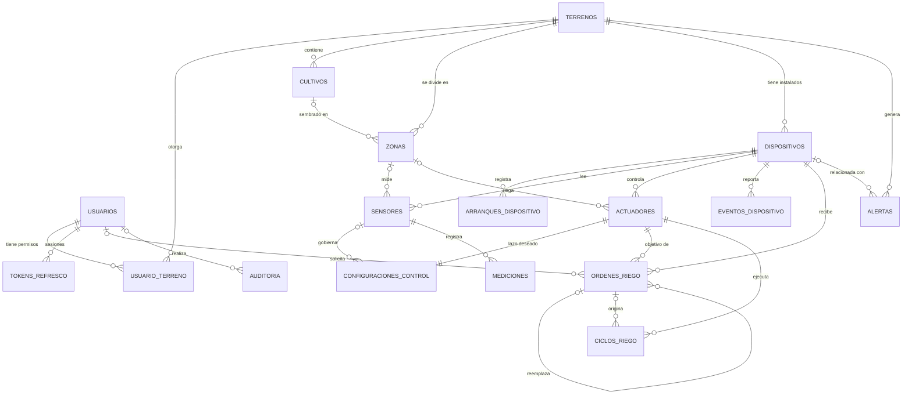

# Modelo de datos — AgroControl IoT

Versión 1.0.2, alineada con el [contrato API IoT 1.0.2](CONTRATO_API_IOT.md).
Script ejecutable: [`database/schema.sql`](../database/schema.sql). Requiere MySQL 8.0.16+ (InnoDB, utf8mb4, fechas en UTC con milisegundos).

## 1. Diagrama entidad-relación



```
Usuario ──(rol)── Terreno ─┬─ Cultivo
                           ├─ Zona ◄── (cultivo actual)
                           └─ Dispositivo (ESP32) ─┬─ Arranques
                                                   ├─ Sensor (HUM1) ──► Mediciones
                                                   └─ Actuador (BOMBA1) ─┬► ConfiguraciónControl (deseada)
                                                                         ├► Órdenes de riego
                                                                         └► Ciclos de riego
```

## 2. Tablas

| Tabla | Propósito | Claves / restricciones relevantes |
|---|---|---|
| `usuarios` | Cuentas; rol global `ADMIN`/`USUARIO`; contador de intentos fallidos | `email` único |
| `tokens_refresco` | Refresh tokens (SHA-256) con rotación y detección de reutilización (`familia`) | `token_hash` único |
| `terrenos` / `usuario_terreno` | Predios y permisos `PROPIETARIO`/`OPERADOR`/`LECTOR` | PK compuesta |
| `cultivos` / `zonas` | Cultivos y zonas de riego del terreno | — |
| `dispositivos` | ESP32: hashes del token actual y anterior (gracia), intervalos, `config_version` deseada/aplicada, snapshot del último reporte, barreras de seguridad reportadas (`hardware_confirmado`, `tope_riego_s`, `reloj_confiable`, `persistencia_ok`, `max_id_orden_procesada`) | `uid` y hashes únicos; CHECK de intervalos y tope |
| `arranques_dispositivo` | Cada `id_arranque` visto (regla de reinicio, contrato 8.5) | único (`dispositivo_id`, `id_arranque`) |
| `sensores` | Sensores y calibración; `calibracion_confirmada` | único (`dispositivo_id`, `codigo`); CHECK 21–4074 y separación ≥ 200 |
| `actuadores` | Estado reportado: modo efectivo, `estado_bomba`, bloqueo (tipo/causa/liberable), (`id_arranque`, `uptime_ms`) del snapshot | único (`dispositivo_id`, `codigo`) |
| `configuraciones_control` | Lazo **deseado**: `modo` (3 valores), origen (`USUARIO`/`SISTEMA`) y motivo, umbrales y tiempos | CHECK histéresis ≥ 5, rangos; defaults de banco |
| `mediciones` | Serie temporal | único (`sensor_id`, `id_arranque`, `seq`) |
| `eventos_dispositivo` | Eventos del firmware (`tipo` VARCHAR) | único (`dispositivo_id`, `id_arranque`, `seq`) |
| `ordenes_riego` | Órdenes con id entero creciente, entrega por arranque, cierre sin ACK y **ACK inmutable** | idempotencia (`solicitada_por`, `idempotency_key`); CHECK TTL y duración |
| `ciclos_riego` | Historial de riegos (inicio/fin/motivo/humedad) | (`actuador_id`, `iniciado_en`) |
| `alertas` | Alertas `ACTIVA`→`RECONOCIDA`→`RESUELTA` con `clave_dedup` | (`terreno_id`, `estado`, `creada_en`) |
| `auditoria` | Acciones de `USUARIO`, `SISTEMA` y `DISPOSITIVO` | (`entidad`, `entidad_id`) |

## 3. Decisiones de modelado

1. **Snapshot + histórico.** El último estado vive en `dispositivos`, `sensores` y `actuadores`, para que el panel sea barato de consultar. El histórico está en `mediciones`, `eventos_dispositivo`, `ciclos_riego` y `ordenes_riego`.
2. **Valores definidos frente a valores reportados.**
   - Lo que define el servidor es `ENUM`: estado de la orden, modo deseado, roles, tipos de alerta.
   - Lo que reporta el firmware es `VARCHAR` validado por la aplicación: modo efectivo, `estado_bomba`, bloqueo, tipo de evento, motivos.
   - Así, un valor nuevo del firmware no hace fallar un `INSERT` ni se pierde un lote de telemetría (contrato §2).
3. **Ids de orden numéricos y crecientes.** Son `BIGINT AUTO_INCREMENT`, siempre ≤ 2^53 − 1 (la aplicación lo verifica; MySQL no admite `CHECK` sobre `AUTO_INCREMENT`).
   - La creación hace `SELECT … FROM dispositivos WHERE id = ? FOR UPDATE`, lo que garantiza que, para cada dispositivo, el orden de los `id` coincide con el de commit y de entrega.
   - Esto permite la marca de agua anti-replay del firmware.
4. **ACK inmutable.** El primer ACK válido llena `resultado`, `codigo_motivo`, `duracion_aplicada_s`, `ejecutada_en`, `ack_*` y `ack_cuerpo`, y no se vuelve a modificar.
   - Un ACK idéntico no hace nada.
   - Un ACK distinto incrementa `ack_conflictos` y se registra en `auditoria`.
   - Para `BOMBA_APAGAR`, dos ACK con `resultado = EJECUTADA` son equivalentes aunque difiera `codigo_motivo` (contrato 7.3.2).
   - **ACK históricos:** `ack_id_arranque_origen` es el arranque en que se generó el ACK y `ack_id_arranque_envio` la cabecera con que llegó. Un ACK sólo actualiza el snapshot de `actuadores` si su arranque de origen es el actual y su uptime es mayor. Nunca reconcilia el modo.
5. **Entrega por arranque.** `id_arranque_entrega` permite que un reinicio pase las órdenes entregadas a `SIN_CONFIRMAR` sin reentregarlas.
6. **Instante de un bloqueo.** `actuadores.bloqueo_desde_*` guarda el arranque, el uptime y la hora UTC en que se activó el bloqueo. Como el bloqueo sobrevive a los reinicios, `bloqueo_desde_uptime_ms` se interpreta siempre respecto a `bloqueo_desde_id_arranque`. Para mostrarlo se usa el orden de prioridad del contrato (sección 7, "Instante del bloqueo").
7. **Orden de los snapshots.** `actuadores.reportado_id_arranque` + `reportado_uptime_ms`: un estado con el mismo arranque y menor uptime se descarta. Un arranque nuevo (registrado en `arranques_dispositivo`) siempre prevalece.
8. **Configuración versionada y sólo creciente.** Todo cambio de `configuraciones_control`, de la calibración de `sensores` o de los intervalos de `dispositivos` incrementa `config_version_deseada` en la misma transacción. Esto incluye los cambios de origen `SISTEMA` (reconciliación de modo, APAGAR en automático).
9. **Rotación de token con gracia.** El servidor acepta `token_hash` o, mientras `token_anterior_expira_en` > ahora, `token_anterior_hash`. El primer uso del token nuevo borra el anterior. Revocar pone ambos a `NULL`.
10. **Deduplicación** por (`id_arranque`, `seq`) en mediciones y eventos (`INSERT IGNORE`).
11. **Tiempo:** UTC; `hora_estimada = 1` cuando se reconstruye a partir de `uptime_ms`.
12. **Valores por defecto de BANCO** en `configuraciones_control` (DESHABILITADO, 30/55 %, 15 s, 60 s) y en `sensores` (3000/1300, sin confirmar). No son agronómicos.
13. **Crecimiento de `mediciones`:** unas 8 640 filas al día por sensor a 10 s. En la fase 3 se añadirán agregados por hora y una política de retención o particionado.

## 4. Datos semilla del prototipo

`npm run db:seed` (backend), con valores leídos de variables de entorno:
- Usuario `ADMIN`.
- Terreno de pruebas, zona "Cama 1" y cultivo de ejemplo.
- Dispositivo `AGC-ESP32-0001` con `HUM1` (Capacitivo D43, sin calibración confirmada) y `BOMBA1`, en modo `DESHABILITADO` con valores de banco.
- Imprime **una sola vez** el token del dispositivo para cargarlo por USB en NVS `agro-api`.

## 5. Cambios respecto a rc1

| Tabla | Cambio |
|---|---|
| `ordenes_riego` | Sin `uuid`: el `id` entero es público. Nuevos `SIN_CONFIRMAR`, `ttl_s`, `id_arranque_entrega`, `ultima_entrega_en`, `motivo_cierre`, `cerrada_por_orden_id`, `cancelada_*`, `confirmacion_tardia`, `resultado`, `duracion_aplicada_s`, `ack_uptime_ms`, `ack_id_arranque`, `ack_cuerpo`, `ack_conflictos`, `confirmacion_inspeccion`. Índice de entrega por actuador |
| `configuraciones_control` | Modo `DESHABILITADO`/`MANUAL`/`AUTOMATICO` con `DESHABILITADO` por defecto. `modo_origen` y `modo_motivo`. Valores de banco. `descanso_min_s` ≥ 5. Se elimina `max_riegos_maximos_consecutivos` |
| `sensores` | `raw_humedo` pasa a 1300 por defecto. `calibracion_confirmada` y `calibrado_*`. Se eliminan `raw_min_valido` y `raw_max_valido`. CHECK 21–4074 y separación ≥ 200. `ultimo_estado` pasa a VARCHAR |
| `actuadores` | `estado_bomba`, `riego_*`, `bloqueo_tipo`, `bloqueo_causa`, `bloqueo_liberable_remoto`, `id_orden_activa`, `reportado_id_arranque`, `reportado_uptime_ms`. El modo reportado pasa a VARCHAR |
| `dispositivos` | Token nullable (revocación), `token_anterior_*` (gracia), barreras reportadas, `version_contrato`, `config_rechazada_*`, `diagnostico`, CHECK de intervalos |
| `arranques_dispositivo` | Nueva |
| `mediciones` / `eventos_dispositivo` | `estado` y `tipo` pasan a VARCHAR. Se añade `uptime_ms` |
| `ciclos_riego` | `id_arranque`, `duracion_programada_s`; `origen` y `motivo_fin` pasan a VARCHAR |
| `alertas` | Tipos actualizados (`BLOQUEO_ACTIVADO`, `ACK_INCOHERENTE`, `CONFIG_RECHAZADA`, `DATOS_PERDIDOS`, `PERSISTENCIA_DISPOSITIVO`, `RELOJ_NO_CONFIABLE`), `orden_id` |
| `usuarios`, `tokens_refresco`, `auditoria` | Bloqueo por intentos, `usado_en`, `actor` |

### Cambios 1.0.0 → 1.0.1

| Tabla | Cambio |
|---|---|
| `dispositivos` | `tls_vigencia` (`MBEDTLS`/`VERIFICADOR`) |
| `actuadores` | `bloqueo_id`: `id_bloqueo` reportado, que se usa para validar `RESTABLECER_BLOQUEO` (`409 BLOQUEO_NO_COINCIDE`) |
| `ordenes_riego` | `ack_id_arranque` se divide en `ack_id_arranque_origen` y `ack_id_arranque_envio`; nuevo `ack_config_version`. Se elimina `confirmacion_inspeccion`, porque la evidencia viaja en `parametros` (`id_bloqueo`, `causa`, `inspeccion_confirmada`) y el usuario queda en `solicitada_por` y en `auditoria` |
| `actuadores` (revisión de 1.0.1) | `bloqueo_desde_id_arranque`, `bloqueo_desde_uptime_ms` y `bloqueo_desde_ts`. El uptime pertenece al arranque en que se activó el bloqueo y nunca se resta de un uptime de otro arranque |
| `ordenes_riego` (revisión de 1.0.1) | *Trigger* `trg_ordenes_inmutables`: rechaza cambios en los campos de la orden y, una vez hay `resultado`, en los campos del ACK (sólo `ack_conflictos` puede crecer) |
| Privilegios (revisión de 1.0.1) | Referencia de usuario de aplicación sin `DELETE` sobre `ordenes_riego`, `auditoria` ni el histórico (sección 8 de `schema.sql`) |

### Cambios 1.0.1 → 1.0.2

| Tabla | Cambio |
|---|---|
| `actuadores` | `rearmes_remotos_episodio` (0/1, común a toda causa `PREVENTIVO`) |
| `ordenes_riego` | El *trigger* `trg_ordenes_inmutables` cubre la lista normativa completa del contrato 13.1.4: `id` y demás campos de identidad y contenido; campos de escritura única (`entregada_en`, `id_arranque_entrega`, `cancelada_en`, `cancelada_por`, `cerrada_por_orden_id`, `motivo_cierre`); estados finales; campos ACK; contadores que sólo crecen. Nuevo *trigger* `trg_ordenes_sin_borrado` (`BEFORE DELETE`) |

Como todavía no hay ninguna base de datos desplegada, `schema.sql` se reemplaza entero. A partir de la fase 2 los cambios irán como migraciones numeradas.
